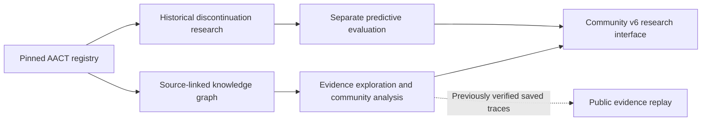

# HeartTrialTwin — Evidence-Grounded Heart-Failure Clinical Trial Intelligence

HeartTrialTwin helps **clinical-trial researchers and evidence reviewers** explore
registry information, source-linked knowledge graphs, trial communities and
historical discontinuation patterns. It brings the course's design, retrieval
and modeling stages into one research framework—not a validated clinical system.

**Reliable predictive discrimination was not established. Risk prediction release
remains BLOCKED.** Registered planned outcomes are not observed treatment results.

## Try HeartTrialTwin

| Option | What you can use |
| --- | --- |
| **[Launch Public Demo](https://akwasianing.github.io/HeartTrialTwin/)** | Verified HTTPS landing page with Launch Demo and View GitHub. One-trial **saved-evidence replay**; no installation or credentials. |
| **[Explore the Full Research Application](docs/REPRODUCIBILITY.md#community-v6-local-research-application)** | Community v6: five local research pages; requires approved external runtime assets and trusted saved models. A clone alone is insufficient. |
| **[View Research Poster](reports/final_project/HEARTTRIALTWIN_POSTER_FINAL_REVIEWED_v1/final/HeartTrialTwin_Poster_FINAL_REVIEWED_48x36.pdf)** | Final reviewed 48 × 36-inch PDF; identical to the author's named final copy. |

The hosted example is **not live GraphRAG, the full Community v6 application,
or validated clinical prediction**. Public verification and deployment evidence
are recorded in the [website verification](docs/PUBLIC_WEBSITE_VERIFICATION.md).
No demonstration video is currently provided.

## Research problem and objectives

Trial-registry records evolve, source evidence is uneven, and later amendments
can contaminate retrospective prediction. HeartTrialTwin investigates how to:

1. Retrieve registered trial facts with exact NCT/source citations and explicit missingness.
2. Explore shared conditions, interventions and exploratory communities without implying clinical equivalence.
3. Compare semantic and graph-based association ranking reproducibly.
4. Describe historical discontinuation patterns and test predictive claims separately.
5. Keep human review, chronology limitations and abstention visible in the interface.

## End-to-end architecture



This is a map of research components, not one validated predictive pipeline.
Community v6 uses integrity-checked local evidence. The separate MiniLM +
GraphRAG path ranks candidates, retrieves **read-only Neo4j evidence**, validates
trial-bound citations and returns supported facts or abstention. MiniLM similarity
is not evidence of effectiveness. GraphSAGE remains experimental, not the default
ranker. The public website runs only the small saved-trace replay.

## Data and research methods

The frozen `HTT-P1-AACT-20260905` cohort uses the **September 5, 2026** AACT
snapshot of ClinicalTrials.gov. It contains selected terminal-status trials,
not all ongoing heart-failure trials.

| Verified component | Count |
| --- | ---: |
| Selected clinical trials | 2,824 |
| Completed / Terminated / Withdrawn | 2,237 / 393 / 194 |
| Knowledge-graph nodes | 28,777 |
| Original source relationships | 79,125 |
| Registered planned-outcome associations | 19,740 |

**Completed is a registry status, not proof of treatment effectiveness.**
The graph preserves submitted/browse conditions separately, interventions, lead
sponsors, planned measures and provenance. Its [manifest](artifacts/cohort_scaling/HTT-KG-AACT-20260905-FULL2824-v1/full_cohort_manifest.json)
and [coverage report](artifacts/cohort_scaling/HTT-KG-AACT-20260905-FULL2824-v1/COVERAGE_REPORT.md)
record missing evidence: 253 trials lack browse rows; 41 lack planned outcomes.

The 2,824-trial research cohort was **not** the predictive training population.
A historical development subset contained 258 qualified records; a separate
later V1 assessment contained 329 binary-evaluable trials. Early archived records
are not automatically original-registration records. See the
[methods and reproducibility guide](docs/REPRODUCIBILITY.md) for distinct populations.

## Main research findings

### Exploratory communities

Saved B3 seed-42 memberships contain **904 communities, including 820 singletons**.
Mean seed-to-seed ARI was **0.648 for B1** and **0.867 for B3**: B3 was more stable
but more fragmented. These are derived shared-information groupings, not clinical
classifications. [Original community results](reports/challenge4_community_graphrag/full_cohort_results/community_sensitivity_v2.json)
and the [evidence index](docs/RESULTS_AND_HISTORY.md) retain their scope.

### Registered-association ranking

Frozen test comparison: **2,219 eligible queries**, the same **2,824 candidate
trials**, observed-graph planned-outcome-to-trial association ranking.

| Representation | MRR | Recall@10 |
| --- | ---: | ---: |
| TF-IDF | 0.07074 | 0.11492 |
| MiniLM | 0.07619 | 0.12078 |
| Context pooling | 0.07841 | 0.12100 |
| Trained GraphSAGE | 0.01124 | 0.02208 |

MRR measures reciprocal association rank, **not clinical prediction**. GraphSAGE
did not outperform semantic baselines. The comparison is descriptive; the inspected
test set must not guide additional model selection. MiniLM is the practical
semantic-integration choice, not a claim of test-set superiority. See the
[saved experiment](gnn_graphrag/experiments/HTT-GNN-ASSOC-RUN-v1/RESULTS.md).

### Historical discontinuation

Recorded discontinuation (Terminated + Withdrawn) varied across phase, intervention
and other registered characteristics. Factor comparisons are **unadjusted,
noncausal historical associations**, with saved uncertainty estimates—not future
risk predictions. Categories may overlap and denominators differ. The
[analysis evidence](reports/reproducibility/COMMUNITY_V6_PHASE3_20261106_v1/RESULTS_INDEX.md)
also distinguishes 24-trial longitudinal feasibility from predictive evaluation.

### Separate V1 predictive evaluation

**329 binary-evaluable trials**: 289 Completed and 40 Terminated; 29 Withdrawn
excluded from 358 provisionally scored records.

| Measure | Saved result |
| --- | ---: |
| ROC-AUC | 0.487 |
| ROC-AUC 95% interval | 0.385–0.589 |
| Average precision | 0.157 |
| Brier score | 0.1100 |

**Reliable predictive discrimination was not established. Risk prediction release
remains BLOCKED.** This status-snapshot conditional assessment is not a validated
ongoing-trial forecast. It is distinct from the older 462-record classification
experiment. [V1 report](V1_INDEPENDENT_EVALUATION_REPORT.md).

## Run the public evidence-replay demo

Python **3.10+**, standard library only; tested with Python 3.14.6.
No database, model, API key or external Python dependency is needed.

```bash
git clone https://github.com/akwasianing/HeartTrialTwin.git
cd HeartTrialTwin
python3 -I -B demos/public_evidence_v1/replay.py --field outcomes
python3 -I -B demos/public_evidence_v1/replay.py --field sponsor
python3 -I -B demos/public_evidence_v1/replay.py --field intervention
python3 -I -B -m unittest discover -s demos/public_evidence_v1/tests -p 'test_*.py' -v
python3 -I -B demos/public_evidence_v1/build_site.py --check
```

The clone includes the required [published saved traces](full_cohort_graphrag/semantic_v1/demo_v2/validation/HTT-DEMO-v2-SMOKE-v1)
and their checksum manifest. Expect `COMPLETE_LISTING` with seven source-cited
outcomes and zero model attempts. Missing/tampered evidence fails closed.
Unsupported effectiveness questions abstain; other NCT IDs are outside this
one-trial replay, not necessarily absent from the registry.
[Detailed replay/browser instructions](demos/public_evidence_v1/README.md).

## Run Community v6

The full local research application provides Trial Intelligence, Community
Explorer, Phase and Intervention Explorer, Operational Risk Dashboard and a
bounded Digital Trial-Twin Scenario Lab.

Follow the [current reproducibility guide](docs/REPRODUCIBILITY.md) before launch:
provision the approved runtime files, trusted saved models and the separate
Python 3.12 UI/worker environments. **There is no approved public download for
the complete runtime bundle**; a source-only checkout lacks 144 of 190 required
assets. Do not substitute data or weaken integrity checks.

After successful provisioning, from the repository root:

```bash
PYTHONDONTWRITEBYTECODE=1 .venv-full-system/bin/python -B reports/challenge4_community_graphrag/hearttrialtwin_community_app_v6/provision.py --check-environments
PYTHONDONTWRITEBYTECODE=1 .venv-full-system/bin/python -B -m streamlit run reports/challenge4_community_graphrag/hearttrialtwin_community_app_v6/app.py --server.address 127.0.0.1 --server.port 8510 --server.headless true --browser.gatherUsageStats false
```

Open `http://127.0.0.1:8510/`. Unvalidated LLM interpretation stays disabled.
Scenario calculations are exploratory, in-sample and noncausal—not validated
prospective risk predictions. Recruitment, safety, efficacy, delay and phase-transition
forecasting remain Not Modeled. [Five-page walkthrough](reports/challenge4_community_graphrag/hearttrialtwin_community_app_v6/README.md).

## Example inputs and outputs

For **NCT00206232**, the verified public replay and local evidence view return:

- Registered lead sponsor: **Baylor College of Medicine**.
- Registered intervention: **Spironolactone**.
- **Seven registered planned outcomes**, preserving source IDs, types, time frames and citations.
- “Did spironolactone improve survival?” → **ABSTAIN**: observed effects are unavailable.

[Launch the verified browser replay](https://akwasianing.github.io/HeartTrialTwin/#evidence-demo).
These are registered facts, not treatment findings.

## Limitations and responsible use

Snapshot values may include later amendments; registration-time feature availability
and event chronology require further qualification. Communities are exploratory;
historical associations are noncausal. Prospective predictive performance and
clinical utility have not been established. The public replay is intentionally
limited; the full app requires approved external assets. Neither is clinical advice.

No new credentials, restricted datasets, private runtime bundle or model weights
are included in this documentation update. The previously exposed Neo4j credential
has **not been confirmed rotated/revoked**; do not reuse it. The offline replay and
Community v6 do not need it. [Security boundary](reports/reproducibility/COMMUNITY_V6_PHASE3_20261106_v1/SECURITY_AND_SCOPE.md).

## Development history and reproducibility

HeartTrialTwin evolved through the course challenges; they are stages of this
project, not separate final systems. [Results and development history](docs/RESULTS_AND_HISTORY.md)
links the original semantic design, five-trial demonstration, classification
experiments, GraphSAGE study, community analysis and final application.
Original challenge artifacts, frozen results and the previous README remain
preserved. [Reproducibility](docs/REPRODUCIBILITY.md) separates public clone-and-run
replay, externally provisioned applications and inspectable research results.

Repository: [akwasianing/HeartTrialTwin](https://github.com/akwasianing/HeartTrialTwin).
