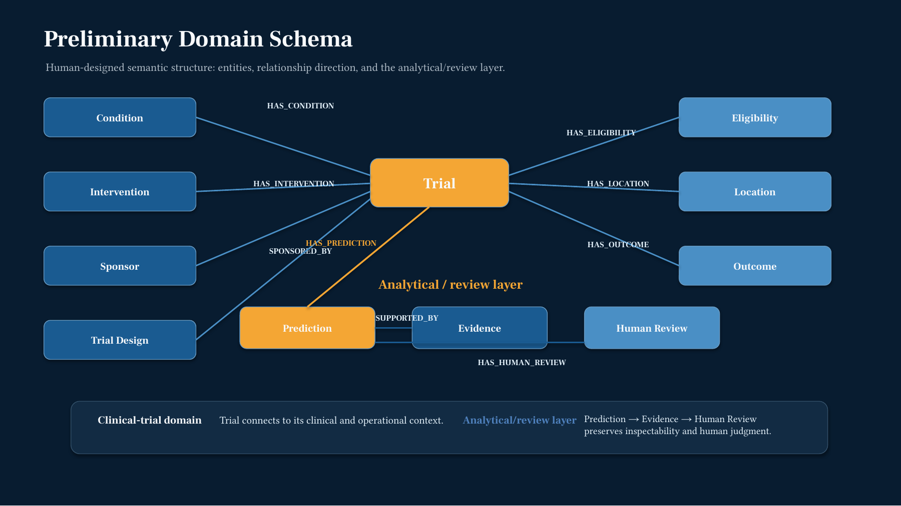
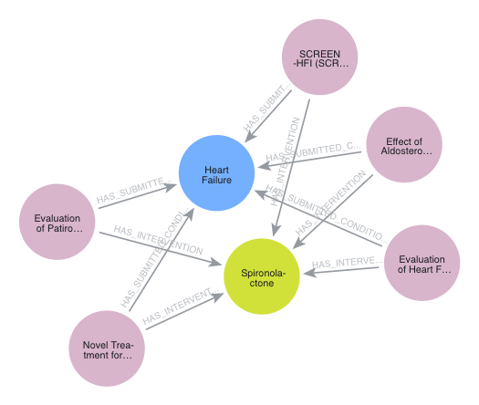
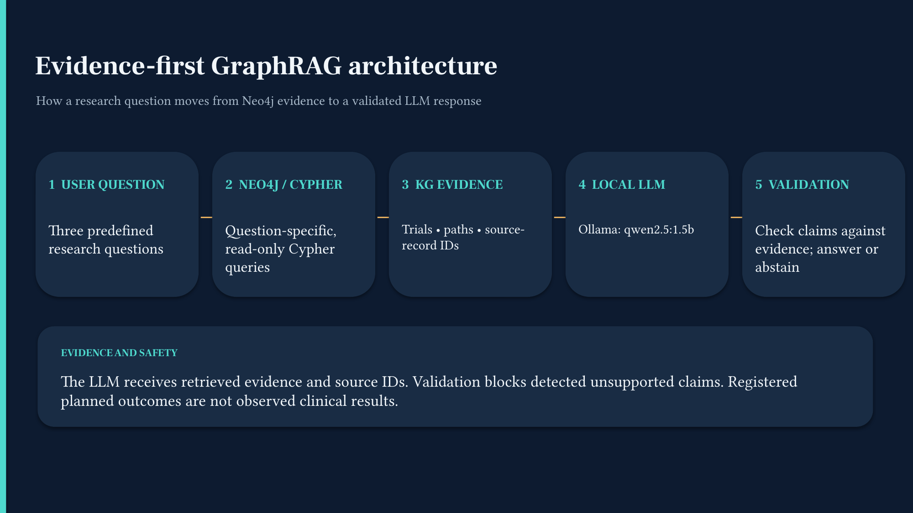
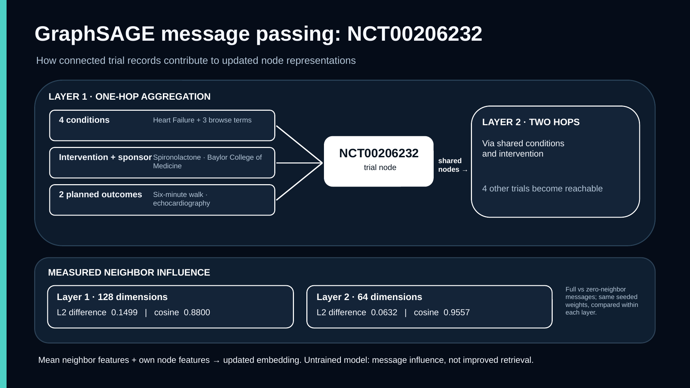
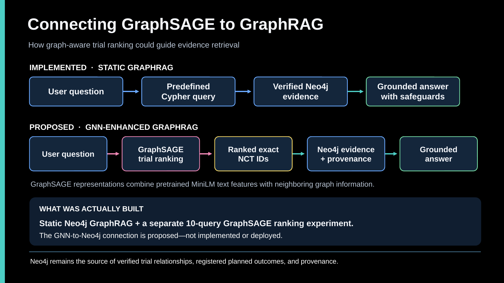
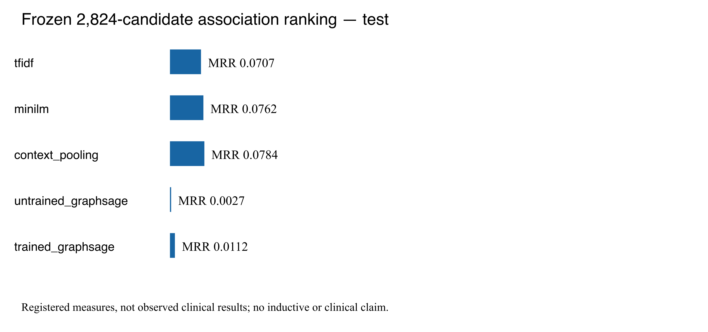
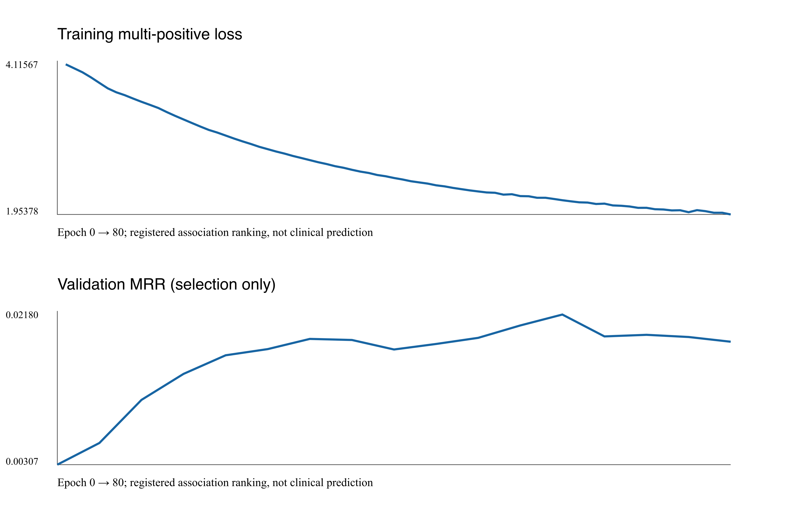
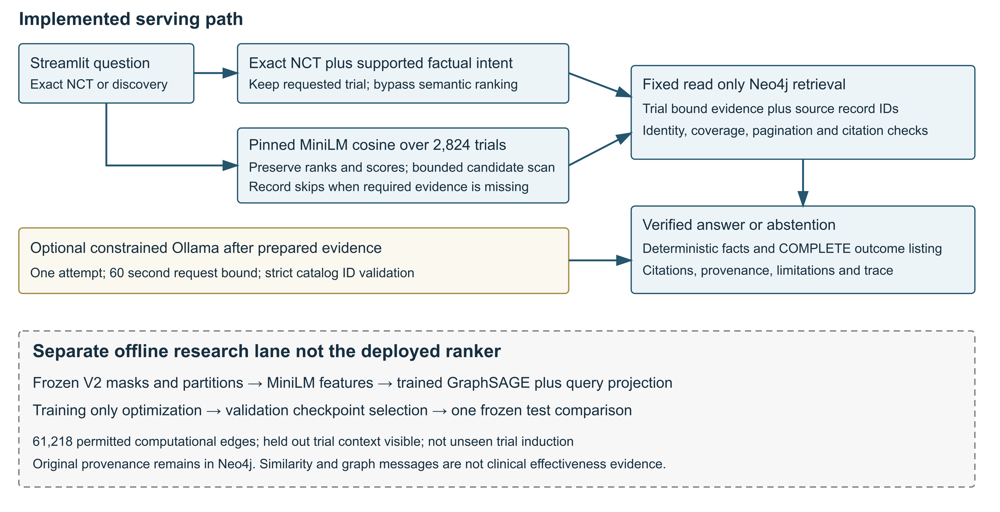
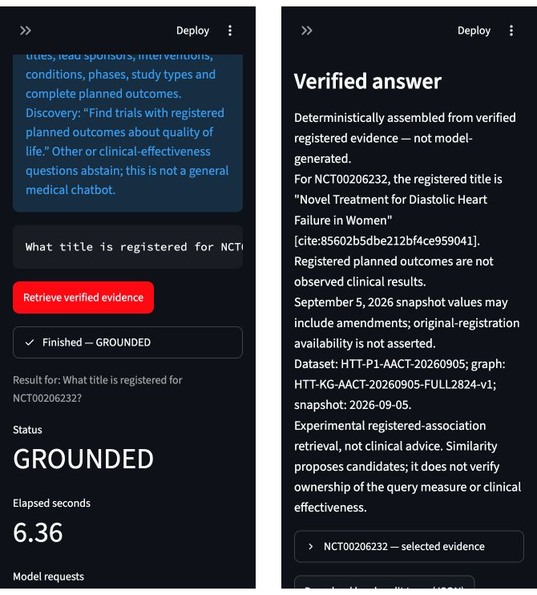

# HeartTrialTwin Challenge 3 Final Report

Human Design AI Design and Human AI Co Design with GraphRAG and GraphSAGE

**Obed Akwasi Aning**  
University of Missouri Kansas City | CS 5588 Data Science Capstone  
Prepared October 25, 2026 | Submission October 26, 2026

**Repository:** https://github.com/akwasianing/HeartTrialTwin

## Abstract

HeartTrialTwin investigates how registered heart-failure trial information can be organized, retrieved, and explained without confusing planned measurements with clinical findings. Four assignments developed a human semantic design, a Neo4j knowledge graph, evidence-grounded GraphRAG, and an experimental GraphSAGE message-passing prototype. Full-cohort extensions beyond those submitted prototypes, completed through October 25, scaled the graph to 2,824 trials, 28,777 nodes, and 79,125 relationships; trained an association-ranking model under a frozen protocol; and delivered a separate MiniLM plus GraphRAG demonstration application.

The principal result is an evidence-first research system rather than a clinical prediction service. Exact trial lookup and semantic discovery lead to read-only Neo4j retrieval, trial-bound citations, complete registered-outcome listings, or explicit abstention. A supervised GraphSAGE model improved over its untrained counterpart but achieved test MRR 0.01124, below MiniLM 0.07619 and context pooling 0.07841. These negative results are retained rather than concealed. The final audit recorded 220 passing offline tests; bounded live cases verified deterministic sponsor, intervention, and seven-outcome answers. No result establishes clinical effectiveness, unseen-trial generalization, or GraphSAGE superiority.

**Reading guide.** Sections 2–5 follow the four assignment dates. Later full-cohort work is explicitly labeled as an extension. Sections 6–8 integrate the evidence, compare design roles, and define the next research boundary. Registered planned outcomes are not observed clinical results.

**Publication status.** The repository URL above is verified from the configured Git remote. The final full-cohort extensions remain local and are not claimed to be available on GitHub. A previously exposed credential must be privately rotated, followed by selective publication review, before any new publication. No credentials appear in this report.

<!-- PAGEBREAK -->
# 1 Project Overview

## Research problem and intended users

Clinical-trial information is distributed across trial descriptions, conditions, interventions, sponsors, and registered outcome measures. A fluent answer can be misleading if it combines fields from different trials, omits records, or interprets a planned endpoint as a measured effect. HeartTrialTwin addresses this information-management problem through explicit graph relationships and traceable evidence retrieval. Intended users include clinical researchers, trial-methodology researchers, trial managers, and data scientists exploring registered study designs.

The broader project originally included trial-discontinuation classification. Challenge 3 does not convert that classifier into a clinical advisory service. Its final demonstrator retrieves registered facts and ranks semantic associations. It does not predict treatment benefit, patient outcomes, or absolute prospective trial-discontinuation risk. The retained membership cohort was selected from trials with observed terminal statuses; it is not a representative sample of all newly registered heart-failure studies.

AACT provides a relational representation of ClinicalTrials.gov records [1]. This project pins the September 5, 2026 archive and dataset identifier `HTT-P1-AACT-20260905`. Snapshot fields may include amendments: they are not certified original-registration values. The graph preserves that limitation rather than backfilling historical claims.

## Objectives and development sequence

The objectives were to define clinically intelligible entities, construct a reproducible graph, answer source-supported research questions, demonstrate genuine message passing, and evaluate whether learned graph representations help association retrieval. Graphs are useful here because a trial–sponsor–outcome path can be inspected directly. Semantic vectors help propose candidates, but similarity alone cannot substantiate a factual assertion.

| Stage | Assignment evidence | Scope actually demonstrated |
| --- | --- | --- |
| October 5 | Human semantic-model presentation | Broad clinical and analytical concepts; original graph design |
| October 12 | AI Design presentation and semantic notebook | Reviewed schema and five-trial Neo4j preparation/import evidence |
| October 15 | GraphRAG presentation and saved traces | Fixed read-only retrieval, local generation, grounding failures and corrections |
| October 22 | GNN presentation and saved diagnostic reports | Seeded untrained GraphSAGE; ten-query in-graph ranking sanity check |
| October 22–25 extension | Full graph prepared October 22; subsequent frozen experiment and final audit | Supervised ranking study and separate MiniLM plus GraphRAG application beyond the submitted prototype |

**Scope of the evidence.** Assignment dates identify the teaching sequence, not a claim that every later artifact existed on that date. The original semantic notebook records design work; scripts, manifests, and saved results substantiate later execution. The implementation is local research software, not externally peer-reviewed clinical validation.

<!-- PAGEBREAK -->
# 2 Human Design Semantic Modeling

## October 5 assignment

The original human design proposed eight clinical concepts: Trial, Condition, Intervention, Sponsor, Trial Design, Eligibility, Location, and Outcome. An analytical layer added Prediction, Evidence, and Human Review. Trials linked to conditions, interventions, sponsors, design, eligibility, locations, and outcomes; predictions linked to supporting evidence and review. Figure 1 reproduces the submitted design, rather than retrospectively attributing the narrower implemented schema to the initial human model.



*Figure 1. Original Human Design diagram, October 5 presentation, slide 6. Reproduced from the submitted slide; its broad analytical layer is a proposal, not evidence that prediction or review nodes were subsequently imported.*

The design used AACT as the structural backbone and considered MeSH condition semantics; SNOMED CT integration was deferred. The human rationale was to connect otherwise separated records, support interpretable multi-hop questions, and retain provenance. The original GraphRAG concept was question → entity identification → Neo4j subgraph → optional text/vector evidence → explanation → human review. It anticipated retrieval assistance rather than an autonomous clinical decision maker.

Human oversight narrowed the implementation to entities actually supported by verified data. The original generic Outcome concept became **PlannedOutcome**, explicitly distinguishing a registered measure from a clinical result. Submitted conditions and browse terms remained source-distinct. SourceDataset became an explicit provenance node. Prediction nodes required exact model/data-version linkage; Evidence and HumanReview nodes were deferred without durable records. Thus, the original design guided the implementation without obligating the project to fabricate every proposed entity.

The semantic notebook also records a human decision to separate prediction from GraphRAG. Status, enrollment, and date fields visible in the broad design are not thereby approved features for the present retrieval or GNN pipelines. The final evidence policies exclude those fields where they could introduce unsupported temporal or clinical interpretations.

<!-- PAGEBREAK -->
# 3 AI Design Neo4j Knowledge Graph

## October 12 assignment and later scaling

Codex assisted with source inspection, schema critique, deterministic preparation scripts, import logic, and validation. The project owner reviewed eight recommendations: six were accepted and two modified. Seven node types were proposed, but the implemented graph used six supported types; Prediction remained conditional on verified result provenance. This was AI-assisted design under human approval, not an autonomous agent constructing clinical truth.

The initial illustration selected five trials deterministically and without outcome labels: NCT00206232, NCT00391846, NCT00574119, NCT00604006, and NCT01130597. Shared submitted Heart Failure and conservatively normalized Spironolactone emerged from that selection. It was not a representative clinical sample. Its 26 nodes and 65 relationships included only two planned-outcome records per trial for demonstration. The later uncapped graph contains seven records for NCT00206232; this difference reflects the cap, not proof of a registry change.



*Figure 2. Authentic Neo4j visualization of the original five-trial shared-condition/intervention subgraph. This is not a visualization of all 28,777 nodes. Source: saved Challenge 3 Neo4j evidence, visualisation.png; whitespace cropped only.*

| Node label | Full-cohort count | Meaning |
| --- | ---: | --- |
| Trial | 2,824 | Frozen membership, linked by NCT ID |
| ConditionTerm | 1,743 | Submitted or browse terms, source-distinct |
| Intervention | 3,417 | Conservatively normalized registered interventions |
| Sponsor | 1,052 | Registered lead sponsors |
| PlannedOutcome | 19,740 | Registered measure, type, and available time frame |
| SourceDataset | 1 | Pinned dataset and graph provenance |
| Total | 28,777 | Full-cohort extension, not the October 12 graph size |

<!-- PAGEBREAK -->
## Graph construction and source verification

The full-cohort extension reads checksum-verified members of `20260905_export_ctgov.zip` and the frozen 2,824-trial membership. Trials are not filtered away because a source category is missing. CSV preparation retains source-record identifiers, trial associations, snapshot metadata, and stable import identifiers. Unique identifiers, endpoints, source hashes, duplicate checks, and graph counts are validated before a separate importer uses parameterized Cypher `MERGE` [2]. Importing and retrieval are distinct operations; the final application uses only read-only retrieval.

| Relationship type | Full-cohort count | Interpretation |
| --- | ---: | --- |
| HAS_SUBMITTED_CONDITION | 5,482 | Trial to submitted condition |
| HAS_BROWSE_CONDITION | 17,587 | Trial to registry browse term |
| HAS_INTERVENTION | 4,716 | Trial to registered intervention |
| LEAD_SPONSORED_BY | 2,824 | Trial to lead sponsor |
| HAS_PLANNED_OUTCOME | 19,740 | Trial to registered endpoint |
| MEMBER_OF_DATASET | 2,824 | Trial membership provenance |
| SOURCED_FROM | 25,952 | Entity source provenance |
| Total | 79,125 | Original directed Neo4j relationships |

The full graph version is `HTT-KG-AACT-20260905-FULL2824-v1`. Source coverage is explicit: 253 trials lack browse conditions, 41 lack planned outcomes, and 528 outcome records lack time frames. Missingness is not evidence that a clinical characteristic or result does not exist. Conservative intervention merging produces fewer relationships than raw intervention rows; collaborators are not silently relabeled lead sponsors.

The following representative read-only pattern illustrates the implemented sponsor/outcome traversal. Production workflows use fixed queries, safe property projections, deterministic ordering, limits, and explicit database/version checks; they do not accept unrestricted model-generated Cypher.

```cypher
MATCH (t:Trial)-[:LEAD_SPONSORED_BY]->(s:Sponsor)
WHERE t.nct_id = $nct_id
OPTIONAL MATCH (t)-[:HAS_PLANNED_OUTCOME]->(o:PlannedOutcome)
RETURN t.nct_id, s.name, o.measure, o.outcome_type
ORDER BY t.nct_id, o.measure
LIMIT $limit
```

Human corrections included narrowing unsupported entities, preserving submitted/browse distinctions, refusing unverified Prediction nodes, and requiring row-level provenance. A successful import does not itself certify scientific correctness. AI-produced code and assertions were checked against manifests, records, mocked tests, and bounded live queries.

<!-- PAGEBREAK -->
# 4 Human AI Co Design GraphRAG

## October 15 assignment

The first GraphRAG pipeline connected Python and fixed read-only Neo4j queries to local Ollama `qwen2.5:1.5b`. Retrieved trial facts, relationship paths, source identifiers, dataset version, and snapshot date formed the factual context. The model could explain that context but could not calculate clinical results, mutate the graph, or create new evidence. This is structured graph-grounded retrieval; it does not implement the community summarization pipeline described in some GraphRAG literature [3, 4].



*Figure 3. Original October 15 GraphRAG architecture, submitted presentation slide 3. The source graph, Python retrieval, local model, provenance gate, and answer remain distinguishable components.*

Three fixed workflows were demonstrated. The NCT00206232 profile trace passed grounding, although its 150-token prose was incomplete. The multi-hop sponsor/outcome query retrieved ten planned outcomes across five trials, but generated prose omitted one sponsor and incurred condition-ID validation errors. The cross-trial comparison retrieved the intended records, but an unsupported generalization about effectiveness was blocked. These are retrieval successes with mixed answer-generation results, not three successful unrestricted reasoning demonstrations.

Actual co-design iterations moved citations and provenance into deterministic output sections, reduced prompts, and corrected false-positive metadata validation. Human review also retained checks against fabricated entities, treatment effects, termination reasons, and invented trial associations. The October 15 deck reported 32 tests; the final audit's 220 tests refer to later, different suites. Neither count is an answer-accuracy percentage.

<!-- PAGEBREAK -->
## Later extension for complete and relevant answers

Scaling exposed a limitation of a small model selecting one to three facts: seven outcomes cannot be represented completely by one selected fact. The validator correctly abstained with `INCOMPLETE_TRIAL_BOUND_LISTING`. The subsequent separate deterministic listing path selects every authorized outcome for a single requested trial and checks the exact set of source-bound evidence IDs, not just the count. It uses zero model attempts, preserves citations and time frames, and abstains if pagination, missing values, source failures, or output bounds prevent a complete answer.

The optional Ollama path retains a strict catalog-ID interface: the model selects one to three authorized IDs or abstains. Valid catalog membership alone is insufficient; narrow question-field and NCT-scope checks also apply. An outcome fact selected for an intervention question is rejected. Unsupported text after an `ABSTAIN:` prefix is not published. Deterministic facts and summaries are labeled as such rather than attributed to the LLM.

| NCT00206232 source record | Exact registered measure | Type |
| --- | --- | --- |
| 1426532164 | Procollagen peptides, troponin I, tumor necrosis factor alpha, Brain Natriuretic Peptide | other |
| 1426532165 | Electrolytes, blood urea nitrogen, creatinine | other |
| 1426532166 | Quality of Life Questionaire | other |
| 1426532167 | New York Heart Association Classification | other |
| 1426532168 | Number of participants with adverse events | other |
| 1426533443 | Echocardiography parameters of diastolic function | secondary |
| 1426534673 | Six minute walk distance | primary |

*Source note. These are the seven distinct design_outcomes.txt records retained by the full-cohort listing. Source spelling is preserved. Exact time frames and citation bindings are retained in the live outcome trace; a registered six-month measurement window is not an observed completion date.*

For example, the verified lead sponsor is Baylor College of Medicine, source `sponsors.txt:381715287`, citation `[cite:3db774038cf4618ff9294543]`. Spironolactone is associated with that same trial through `interventions.txt:392379839`, citation `[cite:21f56031bbf8289fe76bfdcb]`. Presence elsewhere in the graph cannot justify either trial-specific claim.

The safeguards are substantive: **Registered planned outcomes are not observed clinical results.** Snapshot values may include later amendments. No supplied evidence establishes survival benefit or why a trial terminated. Multi-hop traversal establishes registered associations; it does not establish causal reasoning or clinical equivalence.

<!-- PAGEBREAK -->
# 5 Human AI Co Design GNN Enhanced GraphRAG

## October 22 message passing prototype

GraphSAGE learns node representations by aggregating neighborhood information [5]. The original hands-on implementation used PyTorch mean aggregation, not a trained ranking model: 384 normalized MiniLM semantic dimensions plus six node-type slots formed 390-dimensional inputs to two layers, 390 → 128 → 64. Fixed seeds and CPU evaluation made the forward-pass demonstration reproducible. MiniLM provides compact semantic representations [6, 7]; an encoder embedding is not clinical evidence.



*Figure 4. Authentic October 22 message-passing illustration and measurements, submitted slide 4. NCT00206232 has eight semantic neighbors in the capped five-trial graph. The source graph still retains its provenance relationships.*

The 26-node source graph retained all 65 original relationships. Computational message passing excluded 25 provenance-hub relationships, leaving 40 semantic relationships and 80 directed edges after reversals. For NCT00206232, one-hop context comprised four condition nodes, Spironolactone, Baylor College of Medicine, and two planned outcomes; two-hop membership reached the other four trials. Reverse message edges are computational devices, not newly asserted registry relations.

With identical seeded weights, removing neighbor messages changed the layer-1 representation by L2 0.1499 and cosine 0.8800; layer 2 showed L2 0.0632 and cosine 0.9557. Comparisons are within each layer's space, not across incompatible dimensions. Neighbor-type ablations describe message flow, not causal importance. The recorded demonstration and diagnostics took approximately 18.8 ms, and 21 GNN tests passed at that stage.

<!-- PAGEBREAK -->
## Original ranking sanity check and proposed integration

Ten PlannedOutcome nodes queried five Trial candidates using cosine similarity within each representation. Layer 0 used only the 384 semantic dimensions; layers 1 and 2 used their own 128- and 64-dimensional spaces. The exact same candidates and query nodes were used throughout.

| Five-trial representation | Hit at 1 | MRR |
| --- | ---: | ---: |
| MiniLM semantic features | 0.20 | 0.53333 |
| Seeded untrained GraphSAGE layer 1 | 0.30 | 0.53000 |
| Seeded untrained GraphSAGE layer 2 | 0.10 | 0.47500 |

These mixed results do not establish an improvement. Crucially, the target PlannedOutcome–Trial edges remained visible during message passing. This was an in-graph structural sanity check, not held-out association retrieval or generalization. No seed or hyperparameter search was performed to improve those figures.



*Figure 5. Proposed GNN-enhanced GraphRAG architecture from the October 22 presentation, slide 6. GNN ranking would precede authoritative Neo4j evidence retrieval; the slide distinguishes that proposal from the working static pipeline. The final demonstration instead uses MiniLM ranking.*

Human–AI co-design determined what the graph should communicate. The owner required that provenance remain available for evidence while excluding provenance hubs from computational messages. Codex implemented extraction, forward passes, diagnostics, tests, and diagrams under those requirements. The instructor did not require a complete deployed GNN-to-GraphRAG integration; the reported hands-on evidence is not relabeled as one.

<!-- PAGEBREAK -->
## Later full cohort protocol and features

The full-cohort extension changes both scale and evaluation rigor. All 19,740 registered outcome-to-trial associations are preserved as source truth. The frozen `HTT-GNN-ASSOC-PROTOCOL-v2` partitions trials into 1,976 training, 424 validation, and 424 test trials. Source association counts are 13,819, 2,962, and 2,959 respectively. Filtering and query normalization yield 11,712 training queries, 2,068 eligible validation queries, and 2,219 eligible test queries; these are not interchangeable with source-row counts.

Every planned-outcome target edge and its computational reverse is removed before graph features are propagated. Provenance edges also remain outside message passing. Of 100,698 pre-mask semantic computational edges, 61,218 are permitted. The authoritative Neo4j graph is unchanged. The context has 9,036 nodes, with held-out trial context visible: the experiment measures **registered-association ranking within an observed graph**, not inductive generalization to unseen trials.

Family controls conservatively co-group 25 strong unresolved pairs. Sixty-nine weak-candidate trial endpoints are quarantined from held-out query evaluation but remain candidates and graph context. Sixty-two family pairs remain scientifically unresolved; conservative grouping or exclusion is not proof of relatedness. Exact/near-query embargoes include 188 cross-partition near-query candidate pairs. Screening is not exhaustive, and the evaluated population is restricted.

Pinned `sentence-transformers/all-MiniLM-L6-v2` revision `1110a243fdf4706b3f48f1d95db1a4f5529b4d41` uses an effective 256-token limit. The feature bundle contains 9,036 × 390 context features and 11,712 × 384 training-query embeddings; held-out query vectors are generated separately for evaluation. Six type slots preserve the approved schema even though only four context labels are active. NCT IDs and source owner identifiers remain linkage metadata, not semantic features. Status, termination reasons, enrollment, completion dates, and observed results are excluded. Recorded inputs did not truncate at the token limit, and same-environment repeat features had maximum difference 0.0.

The owner approved partitions, masks, embargoes, and scope before performance evaluation. External freeze and execution approvals bind the manifest while leaving the checksum-pinned internal `training_permitted=False` guard unchanged. Training used a separately auditable authorized path, not a weakened default loader. The candidate universe remains all 2,824 trials in deterministic order.

**Integrity anchor.** V2 manifest SHA-256: `b13d662390b687b62a08cc1fb81bd3413f2c9d1fbb3b6ec86438b1a6854cd95b`. This identifies the frozen protocol; it is not a claim that all residual leakage risk has been eliminated.

<!-- PAGEBREAK -->
## Supervised training and ranking evaluation

The trained model uses mean GraphSAGE 390 → 128 → 64 and a trainable 384 → 64 query projection, totaling 141,056 parameters. The prespecified run used CPU execution, seed 20261023, Adam learning rate 0.001, weight decay 0.0001, temperature 0.1, and gradient clipping at 1.0. Multi-positive probability-mass loss supports 669 multi-owner training queries. Sixty-four training-only unlinked candidates are sampled without replacement, excluding known positive, ambiguous, and family associations. Unlinked trials are ranking distractors, not confirmed clinical negatives.

The run made 80 full-graph updates in 112.385 seconds. Validation every five epochs selected epoch 60; the 80-update cap ended training before patience was exhausted. Validation MRR, not test performance, selected the checkpoint. The frozen test was evaluated once afterward. Rankings use the same 2,824-candidate universe. Recall measures the fraction of known owners recovered, Hit measures any known owner, and MRR uses the first correct rank. Coverage is 1.0 of eligible evaluated queries, not all possible cohort questions.

| Representation | Validation MRR | Test MRR | Test Recall at 10 |
| --- | ---: | ---: | ---: |
| TF-IDF | 0.08519 | 0.07074 | 0.11492 |
| MiniLM cosine | 0.08115 | 0.07619 | 0.12078 |
| Context pooling | 0.07935 | 0.07841 | 0.12100 |
| Untrained GraphSAGE | 0.00307 | 0.00266 | 0.00361 |
| Trained GraphSAGE | 0.02180 | 0.01124 | 0.02208 |



*Figure 6. Saved full-cohort frozen-test comparison. Training improves GraphSAGE over the untrained control but not over any non-GNN baseline. The test comparison is descriptive and must not drive additional selection or tuning.*

<!-- PAGEBREAK -->
## Diagnosis and interpretation of negative results

The implementation review found no confirmed neighbor-aggregation, trial-ordering, multi-positive-loss, or positive-exclusion defect. Tiny training-only overfitting reached MRR 1.0, demonstrating optimization capacity rather than generalization. No complete representation collapse was observed. The selected checkpoint's training MRR was 0.20386 versus validation 0.02180; by epoch 80, training increased to 0.23354 while validation fell to 0.01841. That gap is consistent with weak generalization and late overfitting, but does not isolate their causes.



*Figure 7. Actual saved training loss and validation-MRR curves, HTT-GNN-ASSOC-RUN-v1. The selected checkpoint is preserved; no new training or test-guided search was performed for this report.*

Removing neighbor messages under the **same selected weights** reduced validation MRR from 0.02180 to 0.01319. Messages therefore contribute under those weights; this is not a separately trained no-graph ablation. The learned 64-dimensional ranking space may discard useful semantic structure or fail to transfer to held-out query–trial associations. Limited supervision, heterogeneous neighbors, and sampling design remain hypotheses requiring separate controlled experiments.

GraphSAGE consequently remains an experimental comparison, with checkpoint and negative results retained. Context pooling has the highest observed test MRR, but its small advantage over MiniLM is not a demonstrated statistically reliable superiority. TF-IDF has the highest recorded validation MRR; no assertion is made that MiniLM won the benchmark. MiniLM was adopted as the next integration candidate for already verified artifacts, direct semantic-query compatibility, and simpler serving. This engineering choice is not a new test-based model-selection claim.

The exposed test cannot be repeatedly used to optimize a revised GNN. Future changes require a separately documented development experiment and independent confirmation data. Family-aware uncertainty estimates must also be interpreted correctly: family-macro bootstrap intervals cannot be attached to query-micro MRR as though they estimate the same statistic.

<!-- PAGEBREAK -->
# 6 Integrated Architecture and Evaluation

## Implemented application and separate research lane

The final local Streamlit demonstration is a separate opt-in path under `full_cohort_graphrag/semantic_v1/demo_v2/`. Exact-NCT questions preserve the requested trial and bypass semantic ranking. Semantic discovery ranks all 2,824 frozen MiniLM trial vectors with deterministic tie-breaking, then examines a bounded ranked prefix for the evidence required by the question. Neo4j evidence, not ranking similarity, authorizes answers.



*Figure 8. Implementation schematic reconstructed from the final source and audit. Solid serving paths are implemented; the dashed research lane is separately evaluated. Trained GraphSAGE is not the deployed ranker. Neo4j data and citation validation remain authoritative.*

Prepared evidence preserves submitted/browse distinctions, exact trial associations, source tables and IDs, relationship paths, dataset/graph versions, and missingness. Straightforward factual fields use deterministic citation-verified answers. Complete planned-outcome listings use the exact-set validator. Optional bounded Ollama catalog selection remains available for supported explanation requests; it is not unrestricted medical synthesis.

Default discovery examines at most five candidates and seeks two with adequate evidence; absolute limits are ten examined and three selected. Original ranks and scores are preserved. A skipped candidate is explicitly recorded, never reinterpreted as clinically irrelevant. Profiles are bounded at 200 evidence rows; the planned-outcome listing has a 200-item and 50 KB output policy. Oversized, partial, or missing required evidence leads to an explicit limitation or abstention, not silent truncation.

The optional model makes one attempt with a 60-second request timeout; a 240-second backend subprocess bound protects the UI. A socket timeout does not guarantee that the local model server stops computation. Missing Neo4j/Ollama, wrong identity, checksum failure, unsupported intent, and invalid NCT inputs fail safely. Neo4j access uses the dedicated read-only configuration, with no Aura/importer fallback.

<!-- PAGEBREAK -->
## Representative verified live cases

These five cases reuse saved live traces and the final UI capture. They are functionality checks, not a formal accuracy benchmark or a new model-selection experiment. Timings are individual observed wall-clock measurements, not repeated-run latency estimates.

| Question and method | Observed output and evidence | Time | Interpretation |
| --- | --- | ---: | --- |
| What title is registered for NCT00206232? Exact lookup | GROUNDED: Novel Treatment for Diastolic Heart Failure in Women; studies.txt NCT00206232, cited | 6.36 s | Actual final UI capture; zero model attempts |
| Who is the lead sponsor of NCT00206232? Deterministic fact | GROUNDED: Baylor College of Medicine; sponsor record 381715287; 14 evidence records | 0.63 s | Correct trial-bound sponsor and citation |
| What intervention is registered for clinical trial NCT00206232? Deterministic fact | GROUNDED: Spironolactone; intervention record 392379839; 14 records | 0.76 s | Registered intervention, not efficacy evidence |
| What planned outcomes were registered for NCT00206232? Complete listing | COMPLETE_LISTING: all seven source-bound outcomes; 14 profile records | 2.28 s | Exact IDs/citations/types/time frames validated; zero model attempts |
| Find trials with registered planned outcomes about quality of life. Semantic discovery | NCT00939146 and NCT04715490 selected; NCT00012870 skipped for missing outcome evidence | 25.09 s | Bounded evidence-backed selection, not exhaustive clinical relevance |

The title citation is `[cite:85602b5dbe212bf4ce959041]`. Sponsor and intervention citations appear in Section 4. Each citation resolves to the trial-bound evidence, not merely a matching entity somewhere in the graph. The semantic ranking began with NCT00939146 (0.42977), NCT00012870 (0.39009), and NCT04715490 (0.38464); the second candidate had no outcome records. The system retained its score and documented the skip rather than changing the ranker.

Additional saved checks confirm abstention for “Did spironolactone improve survival in NCT00206232?”, NOT_FOUND for NCT99999999, and a missing-outcome limitation for existing NCT00000475. A nonexistent trial, unavailable source evidence, and unsupported clinical inference are different failure categories.

Compared with earlier live model calls, sponsor response changed from 137.60 seconds to 0.63 seconds, and an intervention call previously timed out at 181.15 seconds before the deterministic path returned in 0.76 seconds. These are different execution paths, not evidence that Ollama inference became faster. A saved title call spent 150.18 seconds evaluating 2,374 prompt tokens; output generation itself took only 1.73 seconds for ten tokens. Avoiding unnecessary generation addressed a measured bottleneck.

<!-- PAGEBREAK -->
## Final application evidence and regression testing



*Figure 9. Authentic final-application viewport captures from the October 25 audit. Left: GROUNDED status and 6.36-second timing. Right: exact title, citation, pinned provenance, and safeguards. The saved trace confirms zero model attempts. These are narrow browser captures, not fabricated mockups.*

The final audit recorded **220 passed, zero failed, zero errors, zero skipped**: 102 full-cohort retrieval/evidence/generation tests, 39 semantic-pipeline/demo tests, four UI tests, 44 ranking/execution/diagnostic tests, and 31 saved-fixture protocol checks. Eight regeneration/mutation methods were deliberately not selected and were not counted as passing or skipped. Tests cover citations, cross-trial association errors, pagination, complete listings, prohibited properties, deterministic ranking, input integrity, service failures, and unsupported clinical claims.

Offline benchmark performance, offline software correctness, and live functionality answer different questions. The benchmark evaluates registered association ranking. Mocked tests exercise failure paths and contracts. Saved live traces show particular service interactions. None independently certifies clinical validity, universal question coverage, or a complete agentic system. The shared ten-question Vector/Static/Agentic RAG formal benchmark remains **NOT RUN**; exploratory traces must not be substituted for it.

<!-- PAGEBREAK -->
## Reproducibility and artifact integrity

The serving stack intentionally separates existing environments: `.venv-full-system` supplies Streamlit, `.venv-graphrag` supplies the Neo4j backend, and `.venv-vector-rag` supplies CPU MiniLM/PyTorch. The UI invokes a fixed backend subprocess. The feature manifest records exact encoder and tokenizer dependencies; older requirements files alone are not certified to recreate all three environments on a new machine. Local cached model files and the separately provisioned Neo4j database are prerequisites.

From the repository root, run the existing application without training or regenerating embeddings:

```bash
.venv-full-system/bin/python -B -m streamlit run \
  full_cohort_graphrag/semantic_v1/demo_v2/app.py \
  --server.address 127.0.0.1 --server.port 8502 \
  --server.headless true --browser.gatherUsageStats false
```

Open http://127.0.0.1:8502. Supply the dedicated read-only `FULL_GRAPHRAG_NEO4J_*` settings privately through the ignored local environment file. Do not publish private connection details. Deterministic facts and outcome listings do not require Ollama; optional generation requires the existing local `qwen2.5:1.5b` service.

Representative regression commands are:

```bash
.venv-graphrag/bin/python -B -m unittest discover \
  -s full_cohort_graphrag/tests -p 'test_*.py' -q
.venv-graphrag/bin/python -B -m unittest \
  full_cohort_graphrag.semantic_v1.test_pipeline \
  full_cohort_graphrag.semantic_v1.demo_v2.test_demo -q
.venv-full-system/bin/python -B -m unittest \
  full_cohort_graphrag.semantic_v1.demo_v2.test_app -q
```

The consolidated guide in `reports/final_project/STEP_66G_5_v1/REPRODUCIBILITY_GUIDE.md` includes the remaining ranking/protocol commands and historical experiment commands. This report reused completed logs and did not retrain, rerun costly live generation, or alter experimental records.

Key integrity anchors are the graph manifest SHA-256 `3ef82624d131b36abc1eb9ad4e89b3439fed9f9600b92262c21bbcbfe6cf8757`, the V2 protocol hash in Section 5, and selected checkpoint SHA-256 `58bac20f20d15349063ef36079d204714052b48bb4332c6622e68c43d0d7b936`. Full values, source/output hashes, and mappings remain in their manifests. Serving does not read held-out association truth or the GraphSAGE checkpoint.

<!-- PAGEBREAK -->
# 7 Human versus AI versus Human AI Co Design

The collaboration was governed by explicit human scope and authorization decisions. Codex accelerated implementation and inspection, but neither its fluent explanations nor passing tests replaced scientific review. The following comparison describes actual project actions, not an abstract claim that collaboration is always superior.

| Area | Human Design and decisions | AI assistance | Co-design result and correction |
| --- | --- | --- | --- |
| Semantic modeling | Defined users, broad clinical concepts, and prediction/retrieval separation | Inspected AACT and proposed schema refinements | Narrowed broad concepts to six verified labels; unsupported review/prediction entities deferred |
| Knowledge graph | Approved 6 ACCEPT and 2 MODIFY decisions; pinned cohort | Wrote deterministic CSV/import and validation code | Source-distinct conditions, stable keys, explicit provenance; five-trial cap distinguished from uncapped extension |
| GraphRAG | Required citations, trial scope, abstention, and complete listings | Implemented retrieval, local generation, and diagnostic traces | Corrected metadata false positives without admitting unsupported claims; deterministic source facts replaced fragile citation copying |
| GNN work | Preserved provenance evidence but excluded hubs from messages; approved frozen protocol | Implemented genuine aggregation, training, baselines, diagnostics | Untrained sanity checks labeled honestly; weak trained results retained; GNN not promoted to default |
| Implementation and evaluation | Approved bounded live checks and separate gates; prohibited test-guided tuning | Added mocked tests, hash checks, UI, and evidence summaries | 220 tests plus bounded live evidence; benchmark claims separated from software functionality and publication status |

Three concrete iterations illustrate the value and limits of the process. First, a small local model omitted citation metadata; deterministic provenance construction reduced transcription burden, but claim validation remained necessary. Second, valid catalog facts could still answer the wrong question; narrowly tested field relevance rules blocked planned outcomes offered as intervention answers. Third, one to three model-selected IDs could not exhaust seven outcomes; a separate exact-set complete-listing function solved that structural problem without weakening the old failure condition.

The human also declined to interpret an attractive layer-1 Hit@1 result as GNN superiority, accepted family uncertainty rather than inventing adjudications, and required external approval records before training. Codex helped investigate the weak model instead of automatically retuning against exposed test results. Earlier planner experiments with local models were unreliable and are not represented as a deployed autonomous agent. No independent clinical review, fabricated signature, or individual resolution of all uncertain family pairs is claimed.

<!-- PAGEBREAK -->
# 8 Lessons Learned and Challenge 4

## Lessons and limitations

The strongest achievement is a traceable chain from a pinned registry record to a bounded, cited answer. Graph structure makes source associations inspectable, while MiniLM assists discovery without replacing authoritative evidence. Reliability improved when software explicitly handled incompleteness, wrong-trial associations, unsupported premises, and model failures. The negative GNN result is also a substantive research outcome: optimization success and nonzero message influence did not translate into competitive held-out ranking.

The study has limits. The 2,824-trial membership is terminal-outcome-selected, and the snapshot may include amendments. Registered outcomes are intentions, not observed benefits. Family and query-overlap screening is incomplete; frozen quarantines restrict the primary evaluation population. Held-out trials have observed context, so unseen-trial generalization is untested. Unlinked trials are not verified irrelevant or clinical negatives. Test data have now been exposed and cannot support another unbiased tuning cycle.

The application accepts a narrow set of factual question forms. Strict source-category completeness may abstain even when one requested field is available. Evidence and output bounds can refuse high-volume profiles. Deterministic validators are conservative software rules, not a complete semantic proof system; optional LLM synthesis remains constrained. Discovery is bounded rather than exhaustive, and timings depend on cache, hardware, and execution path. Local multi-environment provisioning and pending selective publication limit fresh-machine reproducibility.

## Challenge 4 plan

The next stage should begin with security and reproducibility: rotate the exposed credential privately, verify read-only grants, audit publishable files, and package dependencies and data instructions. Scientific development should prespecify new confirmation data before any revised ranking model is selected. A focused GNN study could compare separately trained no-message and graph models, residual semantic paths, and carefully justified objectives, with training-only tuning and family-aware uncertainty. These are proposals, not completed improvements.

For retrieval, future work should test evidence paging, field-specific missingness policies, broader question coverage, and candidate sufficiency without rewriting frozen benchmark rankings. The shared Q1–Q10 specification can support a controlled Vector RAG, Static GraphRAG, and Agentic GraphRAG comparison with consistent context budgets, provenance scoring, abstention criteria, latency, and token accounting. An agent must select among bounded read-only tools with a deterministic policy gate; unreliable local planner tests do not justify unrestricted Cypher or a keyword router mislabeled as agentic AI.

**Conclusion.** Across Human Design, AI Design, and Human–AI Co-Design, HeartTrialTwin progressed from a broad semantic model to a working evidence-grounded research application and a reproducible, honestly reported GNN experiment. The deployed MiniLM-plus-Neo4j path supports registered-fact exploration; GraphSAGE remains experimental. The defensible next step is controlled evaluation and improved reproducibility, not a claim of clinical validity or model superiority.

<!-- PAGEBREAK -->
## References

[1] Clinical Trials Transformation Initiative. AACT Database. https://aact.ctti-clinicaltrials.org/ . Project data pinned to September 5, 2026; source snapshot rather than current registry values.

[2] Neo4j. Cypher Manual: MERGE; Operations Manual: Write privileges. https://neo4j.com/docs/cypher-manual/current/clauses/merge/ ; https://neo4j.com/docs/operations-manual/current/authentication-authorization/privileges-writes/ . Technical documentation consulted October 25, 2026.

[3] Lewis, P., et al. (2020). Retrieval-Augmented Generation for Knowledge-Intensive NLP Tasks. Advances in Neural Information Processing Systems 33. https://arxiv.org/abs/2005.11401 . Background for retrieval-grounded generation, not a claim that this project reproduces the original model.

[4] Edge, D., et al. (2024). From Local to Global: A Graph RAG Approach to Query-Focused Summarization. https://arxiv.org/abs/2404.16130 . GraphRAG background; HeartTrialTwin uses fixed structured-graph retrieval rather than this paper's full pipeline.

[5] Hamilton, W. L., Ying, R., and Leskovec, J. (2017). Inductive Representation Learning on Large Graphs. Advances in Neural Information Processing Systems 30. https://arxiv.org/abs/1706.02216 . GraphSAGE method; the present evaluation is observed-graph, not unseen-trial induction.

[6] Wang, W., et al. (2020). MiniLM: Deep Self-Attention Distillation for Task-Agnostic Compression of Pre-Trained Transformers. Advances in Neural Information Processing Systems 33. https://arxiv.org/abs/2002.10957 .

[7] Sentence Transformers. all-MiniLM-L6-v2 model card. https://huggingface.co/sentence-transformers/all-MiniLM-L6-v2 . Project revision: 1110a243fdf4706b3f48f1d95db1a4f5529b4d41; effective 256-token input limit verified in local feature specification.

[8] Ollama. API reference: Generate a completion. https://docs.ollama.com/api/generate . Local structured-output generation and timing metadata.

## Project evidence and rubric coverage

All project paths below are relative to the verified repository root. Original files and saved traces are retained unchanged. This ledger identifies local evidence; it does not assert that untracked full-cohort artifacts are already public.

| Rubric category | Primary report coverage | Authentic evidence |
| --- | --- | --- |
| Human Design 15 points | Section 2, Figure 1 | week 7/Challenge3 Sementic Modeling -Obed.pptx; semantic design notebook |
| AI Design 15 points | Section 3, Figure 2 | reports/challenge_3/HeartTrialTwin_Challenge3_Presentation.pptx; graph manifests |
| GraphRAG 20 points | Section 4, Figure 3 | week 8 GraphRAG presentation; graphrag/results/ October 15 traces |
| GNN co-design 20 points | Section 5, Figures 4–7 | week 9 GNN presentation; HTT-GNN-ASSOC-RUN-v1 reports/checkpoint |
| Architecture and evaluation 20 points | Section 6, Figures 8–9 | demo_v2 live traces; STEP_66G_5_v1 audit/test logs/screenshots |
| Cross-cutting comparison and reflection | Sections 7–8 | Human approvals, diagnostic report, reproducibility guide |

<!-- PAGEBREAK -->
## Reproducibility evidence ledger

**Original assignment artifacts.** `week 7/Challenge3 Sementic Modeling -Obed.pptx`; `reports/challenge_3/HeartTrialTwin_Challenge3_Presentation.pptx`; `notebooks/HeartTrialTwin_Challenge3_Semantic_Design.ipynb`; `week 8/HeartTrialTwin_GraphRAG_Design_Challenge3_Obed.pptx`; `week 9/HeartTrialTwin_GNN_Enhanced_GraphRAG_Obed.pptx`. Figures 1, 3, 4, and 5 reproduce their specified source slides. Figure 2 uses `artifacts/knowledge_graph/Neo4j_Evidence/screenshots/visualisation.png`.

**Data and graph.** `artifacts/knowledge_graph/graph_import_manifest.json` records the initial graph. The full graph manifest, CSVs, and coverage report are under `artifacts/cohort_scaling/HTT-KG-AACT-20260905-FULL2824-v1/`. AACT archive MD5 is `99e62b3f8ae5838b36bc0c2277ad2714` and exact size is 2,526,451,724 bytes. The report reuses recorded verified provenance and does not claim a new archive download or extraction.

**Protocol and features.** `gnn_graphrag/protocols/HTT-GNN-ASSOC-PROTOCOL-v2/`; external decisions in `gnn_graphrag/reviews/STEP_66C_3U_V2_FREEZE_APPROVAL.md` and `STEPS_66D_66F_EXECUTION_AUTHORIZATION.md`; feature specification `STEP_66D_1_MINILM_FEATURE_SPECIFICATION.md`; feature bundle `gnn_graphrag/feature_artifacts/HTT-GNN-ASSOC-FEATURES-v1/`. Feature manifest SHA-256: `e2f167b01b2e83aef1f11ef6e4dba673d741246927a43f30936888beecf99a17`.

**Experiments and diagnosis.** `gnn_graphrag/results/message_passing_demo_v1.json` and `trial_ranking_demo_v1.json` record the original untrained prototype. `gnn_graphrag/experiments/HTT-GNN-ASSOC-RUN-v1/` contains prespecified configuration, training history, selected checkpoint, validation/test results, and the original Figures 6–7 SVGs. `gnn_graphrag/reviews/STEP_66G_1_DIAGNOSTIC_REPORT.md` distinguishes verified checks from hypotheses. These artifacts are not overwritten or re-evaluated for report production.

**Live evaluation.** Sponsor, intervention, complete outcomes, and discovery traces are `01_sponsor.json`, `02_intervention.json`, `03_outcomes.json`, and `04_discovery.json` under `full_cohort_graphrag/semantic_v1/demo_v2/validation/HTT-DEMO-v2-SMOKE-v1/`. Original failures remain in `full_cohort_graphrag/semantic_v1/live_validation/HTT-MINILM-GRAPHRAG-LIVE-v1/`. Final UI evidence, 220-test logs, integrity checks, and the full command guide are in `reports/final_project/STEP_66G_5_v1/`. Figure 9 uses its two real JPEG viewport captures.

**Submission boundary.** This report and its editable source are new documentation only. No implementation, frozen protocol, checkpoint, benchmark, or Neo4j data was modified. The original GitHub URL is included, but full-cohort publication and credential rotation are pending. The PDF is prepared for Canvas; the project owner should review its wording and security status before submission or public distribution.
